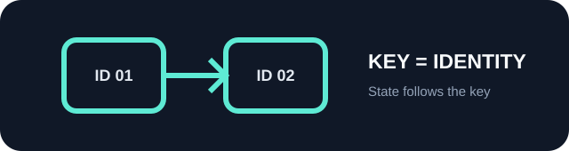

<div align="center">


[](LICENSE)

[](https://github.com/CyberLoop-dev/react-key-reconciliation-lab/stargazers)




</div>

## 🧭 Overview
A small React and TypeScript lab that demonstrates how list keys affect component identity. Increment local counters, then reorder items to compare stable IDs with array-index keys.

## ✨ Features
- 🧩 Toggle between stable item IDs and array indexes.
- 🔁 Prepend, reverse, shuffle, add, and remove list items.
- 🔢 Give each card local state and observe where it goes.
- 🧠 See a concise explanation of the active reconciliation mode.

## 🖥️ Demo
Run the Vite app locally; no hosted demo is configured.

## 🚀 Quick Start
```bash
npm install
npm start
```
Open the local URL printed by Vite (normally `http://127.0.0.1:5173`).

## 🧰 Tech Stack
- React 18
- TypeScript
- Vite
- CSS

## 🗂️ Folder Structure
```text
.
├── assets/mark.svg
├── src/App.tsx
├── src/main.tsx
├── src/styles.css
├── index.html
├── package.json
└── tsconfig.json
```

## 🗺️ Roadmap
- [ ] Add a no-key warning mode.
- [ ] Add a nested component example.
- [ ] Add a resettable state-preservation exercise.

## 🤝 Contributing
Please include a short reproduction and expected behavior in issues or pull requests. Keep examples focused on React key semantics.

## 📄 License
MIT. See [LICENSE](LICENSE).

<div align="center">


</div>
